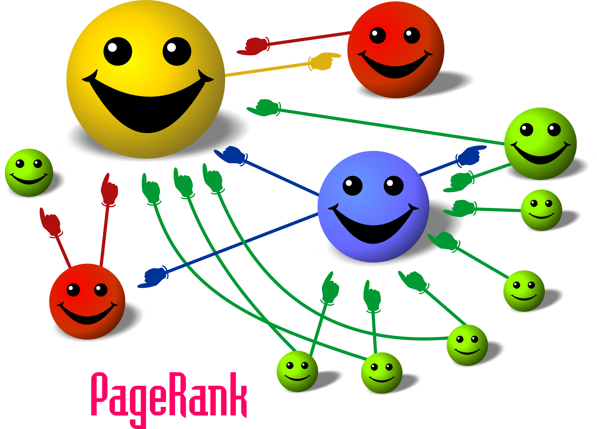
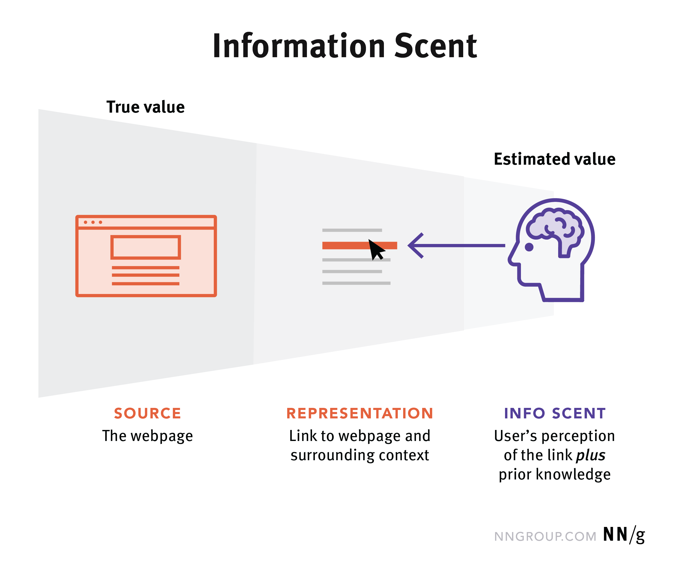
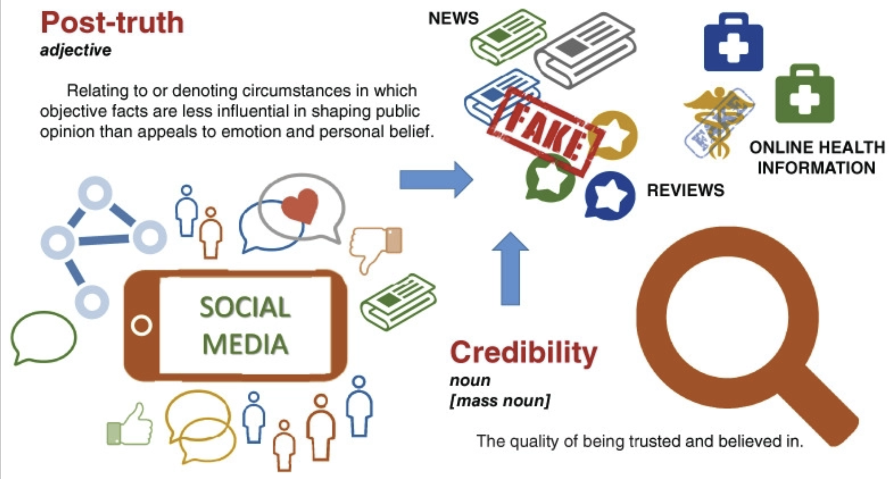
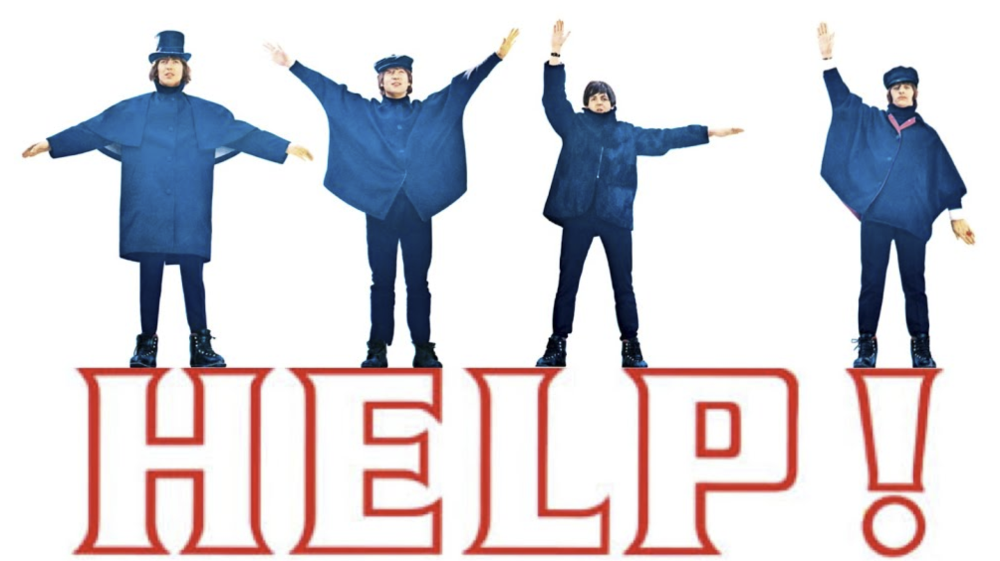
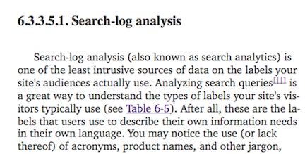
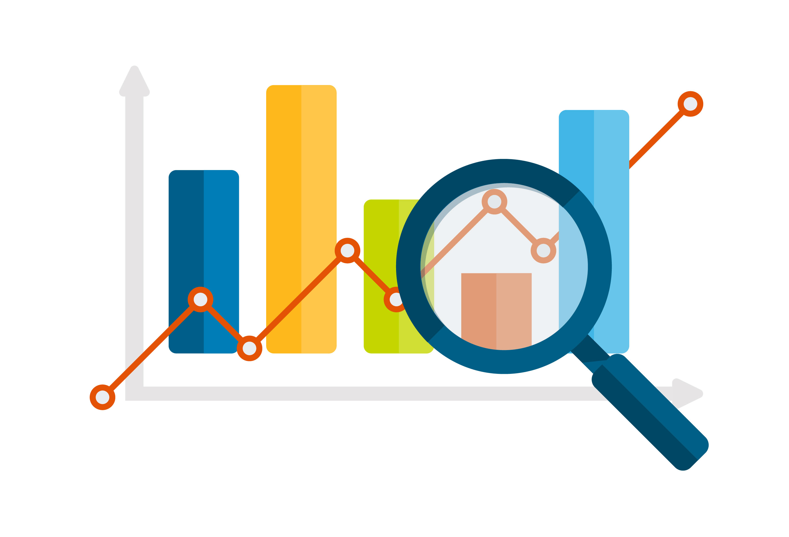
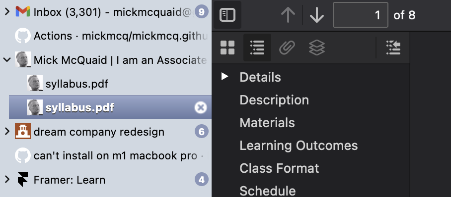
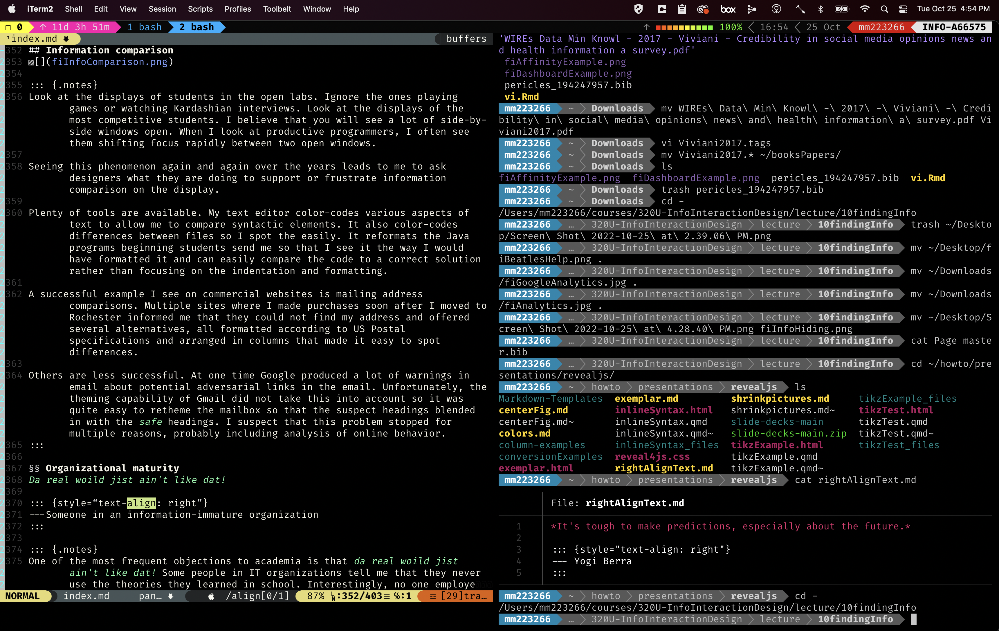

# [Week ELEVEN]{.r-fit-text}

# Finding Information

*In the future, attention will be our most precious resource.*

::: {.notes}
Nearly half a century ago, Nobel Prize winner
Herbert Simon is alleged (the origin of the quote has 
been the subject of some controversy) to have said that 
*in the future, attention will be our most precious 
resource*. He may have meant that so much information 
will be available that we will only be able to pay 
attention to a small fraction of it and that the problem 
of deciding what to pay attention to will become the 
prominent problem of the information-intensive era.

Relationships between businesses and between businesses 
and customers have been transformed by the ease with 
which information can be found online. This 
transformation is ongoing. As an example of current 
change, some retail stores in the mid teens still forbade the use 
of smartphone cameras because they fear the use of 
search engines to make price comparisons. This was 
clearly not sustainable behavior. (To see why this is 
not sustainable, consider the point of view of the 
smartphone user making price comparisons. Is it more 
likely that the smartphone user will eliminate this 
particular store from the selection set or abandon the 
use of their smartphone?)
If behavior is not sustainable, then we have to ask 
whether a steady state will be achieved and, if so, how 
it will differ.
:::

## Search engines
- Revelation of personal information when you search
- What do you think? Should you be compensated?
- Read @Page1999 and Wikipedia on PageRank

::: {.notes}
A person using a search engine reveals a great deal of 
personal information that has value for various stakeholders including business and government.
Some activists believe that individuals should be 
compensated for the personal information they share with 
search engines. They believe that the contribution made 
by users to search engines can be quantified. Others 
claim users are compensated by search results and 
should quit complaining about search engines getting 
rich. But if the value of search results can be 
quantified and the value of user contributions can be 
quantified, policy makers may be convinced that 
consumers are being exploited and may seek to regulate 
search engines. This is one way the search engine 
industry may change in the near future.

Reading: Page and Brin, 1998. The
PageRank Citation Ranking:  Bringing Order to the Web.
[stanford IL pub](http://ilpubs.stanford.edu:8090/422/1/1999-66.pdf)
(dead as of November 2026; use the
[Wayback Machine copy](https://web.archive.org/web/20200101020038/http://ilpubs.stanford.edu:8090/422/1/1999-66.pdf))

Also, the Wikipedia entry on PageRank has some wonderful
graphics illustrating the basic concept.
:::

##

## Exercise: PageRank by hand {.scale85}

Four pages. A links to B and to C. B links to C. C links to A. D links to C. Nothing links to D.

1. Form a pair.
2. Open this [Google Doc](https://docs.google.com/document/d/1S5pjDMohxzzjNv-n9gfBzriARlSZHn8xeSqfhmgZDuk/edit?usp=sharing).
3. Draw the graph. Give every page a rank of 1/4. Use the simplified rule from the Wikipedia article: a page's new rank is the sum, over the pages that link to it, of each linking page's rank divided by its number of outgoing links. Each of you computes two rounds alone, then compare. (6 min)
4. Rank the four pages. Then guess where the ranks would settle if you kept going. (2 min)
5. D's owner wants a higher rank. D has no money and controls only page D. What can D do? What if D could create a hundred more pages? (4 min)
6. Report to the class: your ranking after two rounds, and D's best move. (4 min)

::: {.notes}
Round one gives A 1/4, B 1/8, C 5/8, D 0. Round two gives A 5/8, B 1/8, C 1/4, D 0. The ranks oscillate and settle at A 0.4, B 0.2, C 0.4, D 0, because C hands everything to A, A splits between B and C, and B hands everything to C. Students who get a sum other than 1 have double counted or forgotten to divide by the number of outgoing links.

D's rank is zero after the first round and stays there, however many links D adds, because only inbound links count. That is the premise of @Page1999 and the premise of the entire search engine optimization industry: D needs A, B, or C to link to it. The hundred extra pages are a link farm. If they link to each other and to D and nowhere else, the simplified rule lets them capture all the rank over time, because rank flows in and never flows out. This is the *rank sink* that led Page and Brin to add the damping factor, their random surfer who occasionally jumps to an arbitrary page, and it is why Google spends real money detecting farms. Hold onto D; the gaming the system slide later in the deck is D's story at scale.
:::

##

::: {.notes}
The term *information scent* may be a little confusing 
because it is borrowed from anthropology. It refers to 
the expectation of finding information along a given 
path. The strongest scents represent some balance of the 
easiest catches and the most nutritious meals.

The root concept comes from our primitive ancestors 
foraging for food and using scent to choose paths. When 
the scent stops getting stronger, a given path is 
abandoned.

Similarly, psychologists have found that when the 
expectation of finding information stops growing along a 
given information path, the path is abandoned.
@Pirolli1999 developed a theory of information foraging on this foundation.
The phenomenon drives the propensity of content providers to make themselves easy quarry for information hunters.

The omnipresence of Google as a way for products and services to be 
found has led their providers to focus on providing an 
appropriate information scent online. The result is that 
the web presence for successful enterprises fits into a 
predictable pattern where, to continue the food analogy, 
visitors can get a quick snack, the menu changes 
frequently and predictably, and the dishes are easy to 
find, understand, and digest.

Reading: Tracking the Scent of
Information, APA Monitor, V 43, N 3, P 44.
[Tracking the scent of information](http://www.apa.org/monitor/2012/03/information.aspx)

Further reading:
[Information scent](https://www.nngroup.com/articles/information-scent/)
:::

## Exercise: follow the scent {.scale85}

1. Form a pair.
2. Open this [Google Doc](https://docs.google.com/document/d/1Oc9MBFtocilj1tkS88U9-rs_vqcgl_RKqsEZjdo_Yns/edit?usp=sharing).
3. Each person writes one task to be done on a site you can both reach, phrased as a goal and not as a page name: *find out how to appeal a parking citation*, or *find whether this backpack can be returned after thirty days*. Do not pick a site you know well. (2 min)
4. Take turns. The navigator starts at the site's home page and works toward the goal without using search, thinking aloud. The recorder writes down every link label clicked and, after each click, whether the navigator said the goal felt closer or farther. Stop when the goal is reached or the navigator gives up. (8 min)
5. Together, find the click where the scent was weakest. Rewrite that one label so it would have carried the scent. (3 min)
6. Report to the class: how many clicks, where the scent failed, and your rewritten label. (4 min)

::: {.notes}
Expect navigators to give up after three or four clicks once the goal stops feeling closer, which is @Pirolli1999's prediction done live. Expect the scent to die at labels like *Resources*, *About*, and *Services*, which name the organization's view of itself rather than anything a visitor wants. The words the navigator uses while thinking aloud are the words the labels should have used; the recorder's transcript shows the gap.

The ban on search is there to make navigation visible. If a pair finishes early, let them repeat the task with search allowed and compare. The recorder's list of clicks is a clickstream collected by hand, which is worth saying out loud, because the analytics slides later in the deck are about collecting the same thing by machine for millions of visitors.
:::

## Limits of search engines
- Search by example
- Search for things for which you have no name
- Link rot

## Discussion: rot in this deck {.scale85}

The notes in this deck cite these pages, most of them written down in 2015. With a neighbor:

1. Open two of them. Does each still resolve? To the same page, or to a redirect, a paywall, a bot wall, or a 404? (3 min)
2. For one that fails, look it up on the [Wayback Machine](https://web.archive.org/). How old is the newest capture? (3 min)
3. Report to the class: which links should I replace, and with what? (3 min)

<small>
[PageRank paper, Stanford InfoLab](http://ilpubs.stanford.edu:8090/422/1/1999-66.pdf)\
[Tracking the scent of information, APA Monitor](http://www.apa.org/monitor/2012/03/information.aspx)\
[Credibility in social media, Wiley](https://wires.onlinelibrary.wiley.com/doi/10.1002/widm.1209)\
[Gaming Twitter to troll, Ars Technica](http://arstechnica.com/business/2015/05/how-someone-spent-pennies-to-troll-women-people-of-color-via-promoted-tweets/)\
[Security maturity, Krebs on Security](http://krebsonsecurity.com/2015/04/whats-your-security-maturity-level/)\
[Filers vs pilers, Forbes](http://www.forbes.com/sites/bwoo/2013/02/20/are-you-a-filer-or-piler/) (week eight)\
[Filers vs pilers, The Economist](http://www.economist.com/node/1489224) (week eight)
</small>

::: {.notes}
Checked by script on 2 November 2026: the Stanford PDF, which is the assigned reading for this deck, returned a server error; the Economist page returned 404; Forbes and Wiley refused the script with 403, which may be a bot wall rather than rot, so a browser may get through; Ars Technica answered but silently redirected to a different section of the site; the APA page redirected from http to https; Krebs and NNGroup were fine. Run the check again the morning of class, since the answer changes.

The point for the slide before this one: a search engine can find only what is still there. Link rot is a limit of the Web itself, not of the engine, and the remedies are institutional (DOIs, the Internet Archive, publishers that keep URLs stable) rather than algorithmic. Ask who pays for the Wayback Machine and what happens if nobody does. A model's answer with web search turned off is a snapshot too: it has a cutoff date instead of a 404, and it does not say so unless asked.
:::

## Conversational interfaces
- Asking an assistant now replaces searching for many questions
- The answer arrives without the path
- First mover advantage vs market dominance
- Corrosive influence of OpenAI on StackOverflow

::: {.notes}
When I first wrote this slide the question was whether conversational interfaces would survive their hype. They did, and for a growing share of questions people now ask an assistant first and a search engine second, or never. The next several slides take up what that changes for the ideas in this deck: scent, ranking, who gets paid, and where the evidence of what people want goes. Most of the ideas survive. What moves is where they apply.
:::

## Exercise: the thing with no name {.scale85}

1. Form a pair.
2. Open this [Google Doc](https://docs.google.com/document/d/1LcU7G2DetB0hnQAfT6oW1UpyukMwpRn_cTTjNNKk3qs/edit?usp=sharing).
3. Each person thinks of a thing you can picture but cannot name: a part of an everyday object, a typographic mark, a gesture, a pattern you have seen on a building. Write a one-sentence description for your partner. (2 min)
4. Swap. Find your partner's thing with a search engine, text only. Record every query you type and stop after five failures. (5 min)
5. Find the same thing with a conversational interface. Record the number of turns and whether it was right. Then ask it where its answer came from. (4 min)
6. Report to the class: which channel found it, which query finally worked, and what the conversational interface said about its sources. If it learned the name from a forum, who writes next year's forum post? (5 min)

::: {.notes}
Fallback things for students who go blank: the plastic tip of a shoelace (aglet), the dent in the bottom of a wine bottle (punt), the dot on an *i* (tittle), the wire cage on a champagne cork (muselet), the cardboard sleeve on a coffee cup (zarf), the groove between the nose and upper lip (philtrum), the little plastic table in a pizza box (pizza saver), the loop that holds the end of a belt (keeper), the paragraph mark (pilcrow).

Expect text search to work only once someone discovers the trick of describing function and context rather than appearance, or of typing *what is the name of the* and landing on a forum thread where a human answered the same question years ago. Expect the conversational interface to be faster and, now and then, confidently wrong, which is the credibility problem of the next section arriving early.

The last question in step 6 is the StackOverflow bullet on the previous slide. The forum answers that the model summarizes were written by people paid in reputation on a site whose traffic the model is now diverting. Search by example and the nameless thing are the two cases on the limits slide that conversational interfaces handle better than keyword search, and the closing question is the price.
:::

## Answers instead of results
- A results page is a menu of patches; an answer is one patch
- Scent was carried by labels; now it has to be carried by the prose
- The user judges a paragraph that has no author

::: {.notes}
@Pirolli1999 assumed a forager choosing among patches and following scent from one to the next. A results page is that menu. An answer engine serves the meal, and the path disappears. There is no click after which the goal feels closer or farther, so the follow the scent exercise cannot even be run on an answer. What the user evaluates instead is the prose itself: does it sound like it knows?

This did not begin with chat. Featured snippets and knowledge panels had already made a large share of searches *zero click* before any assistant existed. Generated overviews at the top of results pages extend the same move, and chat assistants complete it. The information diet narrows to one patch chosen by someone else, and the design decisions that used to live in labels and link ordering now live in which sentences get written and which sources get named.

The paragraph has no author. Every credibility concept on the slides that follow was written for sources with authors, publishers, and dates. Hold that thought for the credibility section.
:::

## The engine is still underneath
- Assistants with web access search first, then summarize
- Ranking decides what the model reads
- Generative engine optimization is SEO's second act

::: {.notes}
An assistant that answers questions about current events is not reciting its training data. It issues searches, retrieves the top results, and writes from them. The ranking still happens; it is just one layer down, where the user cannot see it. Page D from the PageRank exercise is still stuck at zero, and now D cannot even see the list it is missing from.

So the gaming continues under a new name, generative engine optimization. The tactics are being present on the sites models read heavily, such as Wikipedia and Reddit; writing in short declarative sentences that quote well; publishing structured data; and, lately, files addressed to crawlers describing what a site contains. Ask students whether any of this is different in kind from the link farm, or only in audience.

With web search turned off, the assistant answers from a snapshot with a cutoff date, which is link rot in a new costume: the page is gone and nothing says so.
:::

## Exercise: check the citations {.scale85}

1. Form a pair.
2. Open this [Google Doc](https://docs.google.com/document/d/1I4ay79VR1XbIP3--g8bKdHJjL_wCCTZE-LClQ6STIZg/edit?usp=sharing).
3. Agree on a factual question with a checkable answer that neither of you knows: a date, a number, who did what. Avoid anything from the past week. (2 min)
4. One of you asks a search engine and records the top three results. The other asks an assistant with web search on and records the answer and every source it cites. (4 min)
5. Open each cited source. For every sentence in the answer, mark whether a cited page says it, says something near it, or does not say it. (6 min)
6. Ask the assistant again with web search off. What changed? (2 min)
7. Report to the class: your counts of supported, near, and unsupported sentences, and whether the cited pages were among the search engine's top three. (4 min)

::: {.notes}
Expect the cited pages to be real and mostly to overlap with the search engine's top results, which is the previous slide made visible. Expect a mix of supported and *near* sentences, because the model paraphrases past what the source says, and a few unsupported ones, often the most specific numbers. Expect the search-off answer to drift on dates and figures or to decline, which is the snapshot problem.

Two things to draw out. First, precision and accuracy, concepts seven and eight on the credibility slide coming up, are suddenly measurable for an answer in a way they never were for a results page, because the answer makes claims and the page only made a list. Second, a cited answer looks more credible than an uncited one even when the citation does not support the sentence, so the footnote itself has become a credibility cue that a designer can place honestly or dishonestly. Keep the counts on the board; the credibility slides refer back to them.
:::

## Who pays for the answer?
- Search paid publishers in visits
- An answer keeps the visit
- Licensing deals, crawler blocking, and paying per crawl
- The compensation question, turned around

::: {.notes}
The search engines slide asked whether users should be compensated for the information they give a search engine. The live version of that question now runs the other way: should publishers be compensated for the pages a model learned from, and what happens to the incentive to publish when the visit never arrives? A search engine paid content providers in traffic, which they turned into advertising and subscriptions. That is why providers made themselves easy quarry, as the information scent notes put it. An answer engine keeps the visit.

The responses so far are of three kinds: licensing deals, in which large publishers and forums sell access to their archives to model makers; blocking, in which hosting and delivery companies refuse AI crawlers by default; and attempts to charge crawlers per page fetched. Add lawsuits over training data. The examples change every semester, so refresh them before class.

The question for designers is Simon's again. If attention is the scarce resource and the answer engine captures it, who will write the next page the engine needs? Someone must forage for the forager. The StackOverflow bullet was an early case of the same problem.
:::

## Where did the questions go?
- Help demand used to be visible: videos, threads, search logs
- Now it is a private chat transcript held by the AI vendor
- The application vendor loses the signal, and the health proxy fades
- The clickstream became a transcript

::: {.notes}
The getting help slides treat YouTube videos and forum threads as a proxy for the health of an application, because they are visible evidence of what people need help with. When people ask an assistant instead, that evidence stops being public. The application's vendor no longer sees it, the forum no longer accumulates it, and the only party that knows what users of a product do not understand is the company running the assistant.

This is also an analytics point, ahead of the analytics slides in the second half of the deck. A clickstream records what people did. A transcript records what they wanted, in their own words, with their misconceptions intact. It is richer than anything my former student at Microsoft had, and it is held by a third party. Ask who should be allowed to read it, and whether an application vendor could ever buy it back.
:::

## Exercise: sketch the results page {.scale85}

1. Form a pair. Sketchbooks out, pencil.
2. Each person sketches the page you would get, five years from now, after typing a question. Decide four things: list, answer, or both; where the sources live; how the page shows how sure it is; and what one click costs the user. One page, no erasing. (5 min)
3. Trade sketchbooks. On your partner's page, mark everything that is hidden and when it would appear, and any comparison the user has to make between two places. (3 min)
4. Together, decide which of the two pages a publisher would prefer and which an advertiser would prefer, and whether either is the one the user would prefer. (3 min)
5. Hold the pages up. Report to the class one design choice and who it serves. (5 min)

::: {.notes}
Expect hybrids: an answer on top, a list below. Expect sources pushed to the bottom or into footnotes, which is an information hiding decision worth naming as such when the hiding and comparison slides come up later. Expect almost no one to have an idea for showing confidence, because nobody has solved it; hedging words, source counts, and color have all been tried and all are easy to game. That gap is the open design problem of this decade and a fair thing to say out loud.

Ten blue links lasted twenty-five years. Ask whether it was a pattern in the week nine sense: what problem did it solve? One answer is that it left the choice of patch to the forager and made the cost of a wrong choice one click. Whatever replaces it has to say what it does with that choice. The publisher and advertiser question in step 4 is the previous two slides applied to a drawing.
:::

## Information credibility

::: {.notes}
Further reading and the source of the image is @Viviani2017, online at
[Credibility in Social Media](https://wires.onlinelibrary.wiley.com/doi/10.1002/widm.1209)

Currently, information available online can come from 
obscured or relatively anonymous sources.

Currently, there are low barriers to presenting 
information online. For many reasons, information 
obtained online may not be credible. Using information 
obtained online requires consideration of credibility, a 
concept which has been defined differently by various
communities. Some of the concepts used in describing 
credibility include the following.
:::

## Information credibility concepts

<small>

1. Technical knowledge, skill or expertise
2. Consistency of actions, values, methods, 
   measures, principles, expectations, and 
   outcomes (definition of journalistic integrity 
   from Wikipedia)
3. Objectivity
4. Pecuniary Interest
5. Agreement with ideas and values held by the 
   recipient
6. Community membership
7. Precision (variance)
8. Accuracy (bias)
9. Falsifiability (using scientific method)

</small>

::: {.notes}
Some of these concepts are discussed in @Rieh2008, where the authors found that college students are mainly interested in whether information is related to a topic and whether it is new, interesting, and convenient. The observed students were less interested in authority, readability, and recency when forming credibility judgments. This contrasts with previous studies of adults where adults were concerned with whether they found information to be accurate, current, novel, objective, reliable, authoritative, trustworthy, understandable, well-written, comprehensive, easy to obtain, and on topic.
:::

## Exercise: rate a source {.scale85}

1. Form a pair.
2. Open this [Google Doc](https://docs.google.com/document/d/1t4pzVriHhDJ_hyOGHIWrmTvwU9xaxlMSCo9QV0Fva80/edit?usp=sharing).
3. Agree on one factual claim you have both seen online this month and are not sure about. (2 min)
4. Each person finds one page that supports or refutes it, as fast as you can. Before reading closely, write one sentence saying whether you believe the page and why. (4 min)
5. Now score your page from 1 to 3 on each of the nine credibility concepts. Leave a blank wherever you have no way to know. (5 min)
6. Compare your one sentence with your scores. Which concepts drove the snap judgment? Are they the ones @Rieh2008 found in college students, or the ones found in adults? (3 min)
7. Report to the class: how many blanks you left, and the one concept that did the most work. (4 min)

::: {.notes}
Expect blanks to cluster on pecuniary interest, precision, and falsifiability. Those are the concepts that take work to assess, and the blank count is the finding. Expect the one-sentence reasons to be about relevance, recency, and whether the page agrees with what the student already thought, which is concept five, and which matches what @Rieh2008 found in students. The order of steps matters: the snap judgment has to be written down before the scoring, or students will reverse-engineer a respectable reason.

The point is not to shame anyone. It is that the list of concepts and the actual behavior diverge, and that a designer who displays credibility cues, such as bylines, dates, citations, badges, and disclosure statements, needs to know which cues users read and which they skip. The next slide, on getting help, is about an information market where credibility is read almost entirely from community signals.
:::

## Getting help

::: {.notes}
In a previous era, selection of computer applications 
was contingent in part on the availability of help for 
usage of the applications. Vendors providing 
applications had to determine optimal expenditure of 
resources on help facilities to be viable in the market.

Today, in contrast, the most prevalent forms of help for 
the use of computer applications are Youtube videos and 
user communities.  At this writing I am specifically 
referring to the Youtube service rather than videos 
services in general, based on a 2013 study of online 
video traffic, identifying Youtube's dominance as increasing.

Youtube has created a low-barrier marketplace for help, 
allowing individuals with relatively few resources to 
assess the best opportunities for profiting from the 
provision of help for computer applications. This means 
that institutional adopters of computer applications can 
use the level of available Youtube help as a proxy for 
the *health* of a given computer application, replacing 
possibly tedious and expensive primary research.

User communities spring up around successful computer 
applications and can be used as a cheap and convenient 
way to evaluate those applications in much the same way 
as Youtube videos. Unlike individual videos, user 
communities may transcend individual products or 
individual vendors. An online help community such as 
Stack Overflow thrives on a reputation that transcends 
that of any individual product. The relative attention 
Stack Overflow pays to a given product may serve as an 
index of that product's health.
:::

## Exercise: help as a health signal {.scale85}

1. Form a group of four and pick two browsers. Chrome and Firefox are the easiest because both are heavily customizable, so people need help with themes, user CSS, and extensions.
2. Open this [Google Doc](https://docs.google.com/document/d/1RNVbDPeRrp5-PjW3rvxgDOWxMx0_g41Q8Xy3Zfi-DUc/edit?usp=sharing).
3. Split into two pairs. One pair studies the YouTube help for both browsers; the other studies the official user community for both. Each pair fills in its half of the table on the next slide. (8 min)
4. Regroup and compare halves. Decide which browser is healthier, and name the one number that most swayed you. (3 min)
5. Decide whether the vendor could fake that number. If so, which number would you trust instead? (2 min)
6. Report to the class. (5 min)

## What to record {.scale85}

:::: {.columns}
::: {.column width="50%"}
**YouTube pair**, for the query *〈browser〉 custom CSS*

1. videos uploaded in the past year
2. age and view count of the top result
3. whether the maker has a channel devoted to the browser
4. whether the maker is monetized: sponsor segments, Patreon, merchandise
5. whether the maker replies to comments
6. tenor of the comments
:::
::: {.column width="50%"}
**Community pair**, for the official forum or subreddit

1. posts in the past seven days
2. time to first reply on five recent threads
3. whether a moderator or vendor employee replied
4. tone of moderation
5. whether the rules and the moderation log are visible
6. the three most common topics
:::
::::

::: {.notes}
The previous slide claims that the supply of help is a proxy for the health of an application. This exercise asks students to operationalize the proxy, then to doubt it. Step 5 sets up the gaming the system slide later in the deck: view counts can be bought, forum posts can be seeded, and a vendor that moderates its own forum can delete the complaints.

When I first wrote this exercise, pre-roll ads were a signal that a maker had an audience. Now ads run before nearly everything, so the better question is whether the maker is monetized by the audience itself. View counts are dominated by a few old videos; the count of uploads in the past year is the better signal of health because it measures current demand for help. I do not predict which browser wins. The answer has changed since 2015 and will change again.

If the room is small, drop the YouTube half and have pairs do the community half for both browsers.
:::

# Navigating Information

Knowing what's going on is a lifelong occupation. You can not expect to use knowledge you acquired years ago without at least some adjustment today. I wanted to devote a talk to information architecture but the received wisdom on information architecture is outdated. The most frequently cited book on information architecture, Peter Morville's book of 2006, seems in 2015 like a prehistoric fossil. Just now, while checking its date of publication I discovered that it is still a bestseller and that Morville released a new edition in August 2015. Nevertheless, the oft-cited 2006 edition contains the extract in the following frame.

##

A sub-sub-sub-sub-section

::: {.notes}
Yes, search analysis, the most popular tool to shape the structure of information artifacts in 2015 when I wrote this, was little more than a footnote in the principal information architecture book. Moreover, what he says in the first sentence about intrusiveness could not be taken seriously in a post-Snowden world.

This is not to criticize Morville. Other than the new edition of his book, he seems to have put the term information architecture into the background, dwelling instead on the interconnectedness of things.

If we look at other texts on information architecture, the situation is no better. For example, we reviewed information architecture *design patterns* from Donna Spencer. These are not design patterns at all in the sense that Christopher Alexander coined the term, nor in the sense that the Gang of Four (Gamma, Johnson, Helm, and Vlissides) popularized the term.

So, what can we do to improve our understanding and use of the few insights that have been gained in the world of information architecture?

Most easily, we can look at the problems we need to solve. Beyond that, we can examine available tools, both conceptual tools and commercial tools to see what problems are being addressed. But a comprehensive account of information architecture will have to wait, and may only ever appear under a different label.
:::

## Exercise: read a search log {.scale85}

1. Form a pair.
2. Open this [Google Doc](URL).
3. The next slide is one week of searches typed into a university department's own site: the query, how many times it was typed, how many results the site returned, and how often a result was clicked. Group the queries by what the searcher wanted. (4 min)
4. Find the queries for which the site has no page, and the queries for which it has pages that nobody clicks. Those are different problems. Name each problem. (4 min)
5. Propose three changes: a page to add, a label to rename, and a synonym to teach the search box. Say which rows of the log justify each change. (4 min)
6. Report to the class. (4 min)

## One week of site search {.scale85}

| Query | Searches | Results | Clicked a result |
|:------|---------:|--------:|-----------------:|
| canvas | 212 | 0 | |
| office hours | 164 | 38 | 71% |
| advising | 131 | 12 | 64% |
| degree plan | 97 | 9 | 18% |
| internship | 88 | 21 | 55% |
| q drop | 76 | 0 | |
| transcript | 63 | 5 | 12% |
| capstone | 59 | 14 | 80% |
| printing | 47 | 2 | 83% |
| drop a class | 41 | 0 | |
| bursar | 31 | 0 | |
| tuition | 29 | 4 | 14% |
| wifi | 28 | 0 | |
| withdraw | 22 | 3 | 9% |

::: {.notes}
The log is invented, but every row is a pattern I have seen in real logs. A reasonable grouping: getting into the course system (canvas); dropping a course (q drop, drop a class, withdraw); paying (bursar, tuition); records (transcript); facilities (printing, wifi); the program itself (advising, office hours, degree plan, internship, capstone).

Zero results with many searches is a vocabulary problem or missing content. Canvas is the single biggest need on the site and the site evidently calls it something else, such as *learning management system*. Q drop is the word students use at UT; the site uses the registrar's word, *withdraw*, which has a page that almost nobody clicks because it does not say *drop*. Results with low click-through is a scent problem: pages exist for degree plan, transcript, and tuition, but their titles do not match what people typed, or the department does not own the answer and should link out to the registrar and the bursar instead of returning its own weak matches.

The three changes most pairs should reach: one page about dropping a course that uses all three words; the withdraw label renamed; and the synonym canvas equals whatever the site calls it. This is Morville's footnote done by hand, with a table and no tool, which is the roll-your-own analysis promised on the Google analytics slide coming up. It is also the follow the scent exercise from the other side: there, students generated the clickstream; here, they read one.
:::

## Analytics

Pictures accompanying analytics articles always feature a magnifying glass

::: {.notes}
It should be well known that commercial and governmental interests track your behavior in detail. It's nothing new.  Only your awareness of it is new. I knew a prosecutor's assistant in the eighties who pieced together a suspect's day by obtaining (often with the legal right to) access to credit card records, phone records, atm records, and more. She claimed she could locate a suspect to within a few meters any time of the day. Stores used to ask for zip codes of customers paying cash and claimed that they could estimate customer income and other market segmentation information with *scary* precision with just that number, a number customers were only too willing to share in an era when they did not understand the extent to which commercial interests could analyze public census data.

You may even be subject to tracking right now of which you are unaware. For example, you may believe that your computer does not store cookies because you have checked a *don't store cookies* box in a browser. Flash-based commercial sites have figured out a way around this, though. They place LSOs (locally stored objects) on your machine when you visit them (assuming you have Flash enabled) and these LSOs perform, among other functions, the work of cookies. Moreover, most commercial interests are able to examine and decode the LSOs that rivals or partners have left on your system. Since they are not stored in the location of *cookies* and are not defined by the vendors as cookies, your browser's *don't store cookies* box has no effect on them.

I have investigated obscure files and readable strings in obscure files on my own system and am satisfied that I would need to pour sulphuric acid on my disk drive to ensure that no one can see that I've visited `terrorists-r-us` or *Al Jazeera* or `sabotage-yr-employer` or whatever it is that you wish Google or the NSA or your boss did not know about.

The study of online behavior through clickstreams is mature. The study of *conversion*, turning website visits into successful commercial transactions, is mature. The business of brokering information about online behavior is mature, well-documented, and difficult to regulate because of the extreme complexities of business relationships in the field. I have lectured about this extensively in another kind of course, but here I just want to emphasize the ubiquity of the analysis of online behavior.

Understand that widespread analytics tools analyze all your computer behavior. A former student working for Microsoft Office complained to me that he has too much data on Office users. He said he could prove anything he wanted to to advocate for a feature or adjustment by simply selecting the *right* 50 million records to support his case. He was troubled by the fact that the data did not help him decide what he *should* do. Instead, the data were best suited to help him justify whatever he already believed he should do.

Different firms have different approaches to analytics. For example, Yahoo! used to pride itself on the privileged position it accords to individual human judgment in its systems. One reflection of this was that Yahoo! would secretly select a different set of users each day to determine what constitutes spam. If these users treated mail as spam, the system would treat it as spam for all other users. Yahoo! would alter the selection each day according to impenetrable rules, allegedly to prevent spammers from opening junk accounts to game the system.
:::

## Google analytics

The logo for Google Analytics in focus

::: {.notes}
Google uses your work with Google drive to upgrade its word processor every day. If nobody clicks on a menu item, it goes away. If everyone performs a series of clicks that demonstrate confusion, the guidance is changed to minimize the clicks.

Google aspires to store all your personal information. It watches your use of the files for this class and adjusts its navigation features daily. There is no question that it must face the same problem as my former student at Microsoft. I illustrated this in class with the anecdote about the dispute over *Reply* and *Reply-all* in Gmail. There are millions of users representing each side in any argument and sometimes intuition leads us astray.

It surprises some students to discover how easy it is
(A) to obtain analytics tools for free, and (B) to do roll-yr-own analysis of samples of data using conceptual tools rather than commercial tools.
Google provides free tools and will provide a private google engine for your office's network storage for very little money.

Of course, while Google helps you they will also be helping themselves by understanding better how you use their tools, even if you have an agreement that prevents them from examining the contents of data. They often don't need contents to infer important details. I once heard a researcher specializing in communication networks claim that he could easily distinguish between bin Laden planning a family wedding and a bombing campaign from features of the email traffic without any access to the contents of the emails. And I mean traffic, not the identities of recipients. Information has characteristics beyond semantic content and many of these characteristics are exploited in the design of information artifacts.
:::

## Gaming the system

::: {.notes}
You probably know that people try to game google every day. People try to interfere with every major online system. Just this week, a case was publicized where a hacker exploited twitter's ad payments and policies to achieve a social (actually anti-social) end that twitter could not have foreseen by modeling all its advertisers as wanting to make customers happy. See
[gaming twitter to troll](http://arstechnica.com/business/2015/05/how-someone-spent-pennies-to-troll-women-people-of-color-via-promoted-tweets/)

There are fields of study joining computer science and economics called reputation systems and recommendation system and incentive-centered design seeking to minimize the damage from exploits like the twitter troll. Yet, more important than the work of these fields is the simple fact that they exist and that their leaders are sought by eBay, Amazon, and other major players to improve their systems. The results of exposing systems to adversarial use is that they can be made stronger than they could ever be by *a priori* planning.

A key issue for information architecture is that it is possible, though not always advisable, to change information architecture in the face of behavior. This fact means that some planning mistakes may be immediately correctable so there may be some limit to the value of planning. There may be diminishing returns to additional planning beyond some point.

Unfortunately, what I said in the previous paragraph is sometimes used as an excuse to avoid planning due to impatience. If smooth processes are not in place to take advantage of the flexibility of contemporary information artifacts, then the sacrifice of planning is meaningless. I'll say more about this under the heading of organizational maturity.
:::

## Metadata
data about data

::: {.notes}
As we've discussed, metadata is data about data. If you have a customer list that has headings for name, address, and phone, then the words name, address, and phone are metadata, as are any other headings or descriptions of the contents of the lists. There is all kinds of metadata to use in building an information artifact. The exercise in which you sketched artifacts involved contained metadata. For instance, the concept of a receipt is metadata, while the receipts themselves contain data. Even the labels on the receipts like *total* are metadata.

A surrealistic experience in my past was a programming job where extensive metadata was developed, maintained, and hoarded. Guess which of three surprised me the most! Well, it is very hard to develop and maintain metadata so I was really surprised that they were able to find the resources to do that. But when I discovered that metadata was inaccessible to customers, I was more deeply puzzled. How can you justify charging high prices to people so that you have the resources to work with metadata? The only way is to make use of that metadata in a way the customer can appreciate.
:::

## Information Architecture

<small>

The Information Architecture Institute offers the following definition of information architecture in their pdf, referenced in the Wikipedia article on Information Architecture.

We define information architecture as

- The structural design of shared information environments.
- The art and science of organizing and labeling web sites, intranets, online communities, and software to support usability and findability.
- An emerging community of practice focused on bringing principles of design and architecture to the digital landscape.

Findability now has a second audience (about half of all Internet traffic): the crawler and the agent, which read metadata, not layout.

</small>

::: {.notes}
This definition troubles me for several reasons. Part 1 is too vague and part 3 is too self-serving. Part 2 seems the best except that there is not a demonstrable art or science to information architecture and usability is the province of all designers. Really the only word in the definition that makes sense to me is *findability*. This is the key contribution of information architecture as far as I can tell. I would therefore define information architecture as the collection of techniques used by the builders of information artifacts to improve the findability of information.

That definition assumed a human doing the finding. A site now has two other readers: the crawler that feeds a model, and the agent that browses on a user's behalf and never shows the user the page. Automated traffic has been roughly half of all web traffic for years, according to the annual bot reports from Imperva and Cloudflare; check the current year's figure before class. Neither reader reads layout. Both read structure and metadata, so consistent labels, clean hierarchies, structured data, and metadata that is actually exposed matter more than they did when the audience was only human. This is a late vindication of the metadata slide coming up: the shop that hoarded metadata its customers never saw would today be invisible to the readers that decide whether a human ever arrives.
:::

## Information architecture tools
- conceptual
- commercial

::: {.notes}
One way to classify tools is to divide them into two kinds, conceptual and commercial. A flowchart is an example of a conceptual tool. Balsamiq is an example of a commercial tool. I claim that conceptual tools are vastly more important than commercial tools, although I can rarely convince students of that. Perhaps I should claim that durable tools are more important and point out that you can not be sure which commercial tools are durable. The most popular commercial tool of yesteryear is largely forgotten today.
:::

##

::: {.notes}
If you look at the tools on the Information Architecture Institute website, they remind me of Baby Busy Box, available on Amazon and offering hours of absorbing activity! They are commercial tools and templates, slide shows and checklists. They tell us about the needs of people building information artifacts but they can not fulfill those needs. They are worth examining to help focus a discussion but there is no clear evidence that they solve problems. Take for instance the so-called design patterns product. Like the Spencer book, it does not show anything that we can truthfully call a design pattern. Instead, it contains examples of screen elements, such as menus.

So we can identify some needs, such as information hiding, information comparison, and information mapping from this website.
:::

## Information hiding

::: {.notes}
We need to focus. We suffer from distraction. We want to expose only the information we need right now. And when I say us, I include others living in the privileged world of connected information. I just heard a BBC radio program that began with Bansuri flute music from India. The host asked the panelists how it made them feel. Every single one of them began by praising the music as a respite from their busy lives, then each one sharply veered into a critique of the Internet, contemporary technology, 24/7 connectivity, and devices in general. Wow! Well, at least they made it clear that anxiety may be produced by information availability.

You may notice that, when I display a browser window in class, there is usually a tab list on the left side. You may have noticed that the tabs are grouped and that only the top tab in each group is visible if my browser is focused on a page from a different group. That is an example of information hiding.

I use a folding text editor, another example of information hiding. A folding editor allows me to hide part of the file I'm editing under a *fold*. It is conceptually like folding a letter to expose, say, the salutation and signature while keeping the body hidden. One way I use it is to show all the boldface headings in this document and only show the body text of one heading at a time. This helps me see my place in the overall structure.

Menus are examples of information hiding. The design of a menu represents choices about which information to hide at a moment when other information is exposed.

All this suggests you need to know which information to hide and when before you think about specific tools for information hiding. You need to know which information matters when and why. Within the past 72 hours I as a consumer have undertaken an online transaction that went through several steps, represented in part by a numbered list at the top of the display and separate pages shaded to focus on each step of the display---and some of the information needed on one panel was trapped on another panel, while irrelevant information was available on the panel I could not complete. What is the problem? Do they not see from clickstreams that their users have to go back and forth between these panels to convert? Do they not do walkthroughs with their wireframes? Is management so brittle that they can not easily fix things they notice? Or have they not considered information hiding? I, as the customer, can not see inside the black box. All I know is that there are a number of ways any complicated commercial experience can go wrong.
:::

## Information comparison

::: {.notes}
Look at the displays of students in the open labs. Ignore the ones playing games or watching Kardashian interviews. Look at the displays of the most competitive students. I believe that you will see a lot of side-by-side windows open. When I look at productive programmers, I often see them shifting focus rapidly between two open windows.

Seeing this phenomenon again and again over the years leads to me to ask designers what they are doing to support or frustrate information comparison on the display.

Plenty of tools are available. My text editor color-codes various aspects of text to allow me to compare syntactic elements. It also color-codes differences between files so I spot the easily. It reformats the Java programs beginning students send me so that I see it the way I would have formatted it and can easily compare the code to a correct solution rather than focusing on the indentation and formatting.

A successful example I see on commercial websites is mailing address comparisons. Multiple sites where I made purchases soon after I moved to Rochester (and then again when I moved to Austin) informed me that they could not find my address and offered several alternatives, all formatted according to US Postal specifications and arranged in columns that made it easy to spot differences.

Others are less successful. At one time Google produced a lot of warnings in email about potential adversarial links in the email. Unfortunately, the theming capability of Gmail did not take this into account so it was quite easy to retheme the mailbox so that the suspect headings blended in with the *safe* headings. I suspect that this problem stopped for multiple reasons, probably including analysis of online behavior.
:::

## Discussion: what your app hides

1. With a neighbor, open the app each of you used most today. Name three things it hides on its first screen, and say when each one gets exposed. (3 min)
2. Name one comparison it makes you do across two screens, holding a value in your head. Could the two be side by side? (3 min)
3. Report to the class. (4 min)

::: {.notes}
Expect settings, account details, older messages, and the total price until the last step of a purchase. The last one is hiding done against the user, and is worth naming as such. For comparisons, expect two products, two flights, two apartment listings, a message and the message it replies to, and a photo before and after an edit. The word *when* in step 1 is the lesson from the information hiding notes: hiding is a decision about time, about which information matters at which moment, before it is a decision about menus, folds, or tabs.
:::

## Organizational information maturity
*Da real woild jist ain't like dat!*

::: {style="text-align: right"}
---Someone in an information-immature organization
:::

::: {.notes}
One of the most frequent objections to academia is that *da real woild jist ain't like dat!* Some people in IT organizations tell me that they never use the theories they learned in school. Interestingly, no one employed at Google or Apple or Microsoft or Adobe tells me that. Instead, people at the most competitive firms often ask extremely probing questions at the limits of academic knowledge. So I must suggest that you consider the maturity of an organization before labeling its place in the real world. There are maturity metrics in all branches of information technology. I recently came across one described by Brian Krebs, the person whose blog you should read regularly if you read nothing else about information security. See
[security maturity](http://krebsonsecurity.com/2015/04/whats-your-security-maturity-level/) and note that this model is easy to understand and verify, having three levels.

@Proenca2016 surveys twenty-two information systems maturity models. These models have an average of about five levels of maturity described and contain definitions for maturity of management of the information resource, as well as prescriptions for attaining higher levels of maturity or at least characteristics of organizations having varying levels of maturity.

One example is found in @Spruit2015, which surveys models of master data (this is data used as a reference by an organization about persistent objects, such as employees and customers) and arrives at a five-level model: initial, repeatable, defined process, managed and measurable, and optimized. An example of an optimized organization might be Amazon, where each business unit is required to have an API allowing other business units to access its information services.

No matter what a prospective employer tells you, the telltale signs in a maturity metric table speak clearly to organizational maturity with respect to information. You have to identify the relevant signs for the way information is treated in the enterprise. For example, you should ask about metadata and not be satisfied by vague answers like *we should do a better job on metadata*. The same is true for tools, both conceptual and commercial. If an organization uses deskilling tools and outsources critical skills, its information maturity level must be low.

You may, however, wish to work in a low maturity organization if you are being brought in as an educator and have the latitude within your job description to improve the information maturity of the organization. A high information maturity organization might be better suited to a junior employee, interested in learning from an optimized environment.
:::

## Exercise: the maturity interview {.scale85}

1. Form a pair.
2. Open this [Google Doc](https://docs.google.com/document/d/1F1cHtbCu5gJVPgc3xcr70M2StJ7dNayhCQv7IOXX_nU/edit?usp=sharing).
3. Each person writes three questions to ask a prospective employer that would reveal how the organization treats information: its metadata, its tools, and who is allowed to change what. A good question is one where a vague answer is itself an answer. (4 min)
4. Take turns. The interviewer asks. The employer answers as an organization at level one or two of the five levels in @Spruit2015, without saying so and without lying outright. (5 min)
5. Swap roles. This time the employer answers as a level four or five organization. (4 min)
6. Together, rewrite the one question that failed to separate the two. (2 min)
7. Report to the class your best question and the vague answer it drew. (4 min)

::: {.notes}
The five levels in @Spruit2015 are initial, repeatable, defined process, managed and measurable, and optimized. Good questions sound like these: who owns the definition of *customer* and what happens when two systems disagree about a customer's address; when did you last retire a tool, and why; can another team get your data without emailing you; where is the metadata written down, and who reads it. The level-one tell is the answer from the notes, *we should do a better job on that*, delivered sincerely. The level-five answer to the third question is Amazon's rule that every unit exposes an API.

Students who have interviewed will recognize that these questions are rarely asked, and that interviewers are rarely asked anything revealing by candidates. The exercise closes the deck because it turns everything before it into something a student can use next spring.
:::


